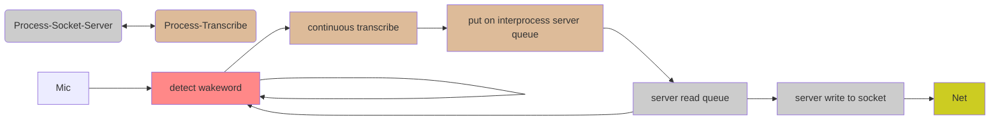
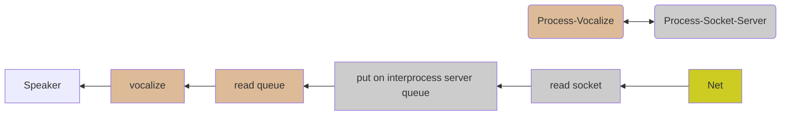

# SocketVoiceServer
## Introduction
This software makes a vocal interface between a human user and a software application like a LLM or any other interactive software.
This software is based on Python language, for this reason it can be used in any hardware with Python interpreter. But it is also compiled (with Nuitka python compiler) for Raspberry Pi 3 system, or for any other Raspberry Pi system with "Cortex-A53 (ARMv8) 64-bit SoC" like Raspberry Pi 4/5 or Raspberry Pi Zero 2W. But in this last case, 500MB memory is not enough and Raspberry Pi Zero 2W needs zram use (with a sensitive trimming). This server needs about 400/600 MB available (or more). Message length are critical if memory is limited. 
In this version (v2), a WakeWord detection is added. The receive process starts with a openWakeWord software, to detect a waking word, ("alexa" for default). When it is detected, receive process commute on continuous transcriber until end of phrase (or time-out). Then a new wakeword detection is waiting. A short beep testifies wake word detection. 
### Use
Use hardware with a sound and microphone system (i.e. a USB sound card on Raspberry Pi). This software system uses default sound card in the sound cards list. This software is configured for Italian language, but it can use other languages changing model, for sound encoding and vocalizing, by configuration file "SocketVoiceServerConfig.conf".

**Using binary on Raspberry Pi:**
- Start server by "StartServer.sh"
- Start your client application on the local network (or on the "localhost") using network port 50880. (This port is changeable by configuration file ).
- Receive microphone message by socket and send possible vocal message writing on socket.
- A Python client is provided as example and test. This client makes a simple echo, and can run on a PC or other hardware linked in the local network (192.168.1.*). Its name is "SimpleEchoClient.py".
- You can use Python version too, by editing "StartServer.sh" (see comments). But in this case you have to install python modules used.
**Using Python version on Windows**
- Start server by "StartServer.bat"

## System architecture

## Installation note
If target is Raspberry Pi, install last OS on a SD card by Raspberry Pi Imager with 64 bit version. For a specialized use, or for reduced hardware (i.e. Raspberry Pi 3) format SD with a lightest OS version (without GUI).
Set the sound card as default in *alsa* list. Download the "SocketVoiceServer.zip" and unzip it. Use "sudo chmod 755 *" command to make files executable. 
If you use binary software version, you don't have to worry about several python module to install, because the binary programs have all compiled modules inside. But binary programs must be used only in Raspbian on "Cortex-A53 (ARMv8) 64-bit SoC". For different hardware you have to recompile python script using bash script in "Utility" directory and the correct version of Nuitka compiler.

Note that compiled software is about 3 times faster.

Using python scripts, instead, is multiplatform but it needs the istallation of some module like soundevice, vosk, piaudio, piper etc. In any case the main program is "SocketVoiceServer(py/bin)".

